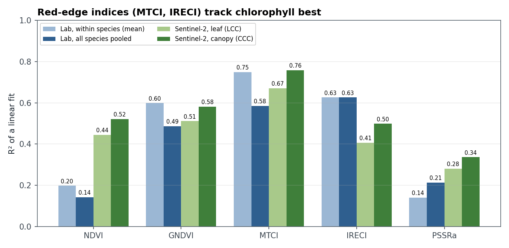
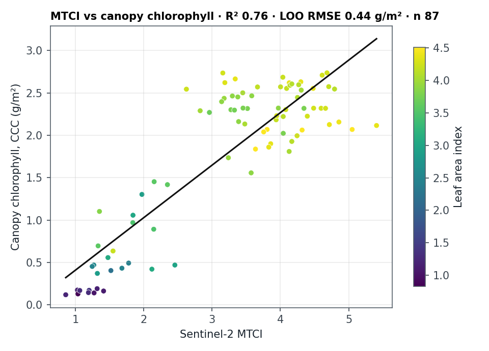
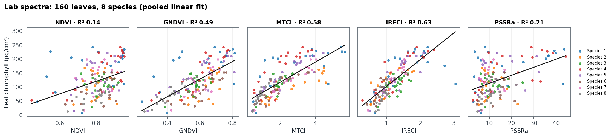
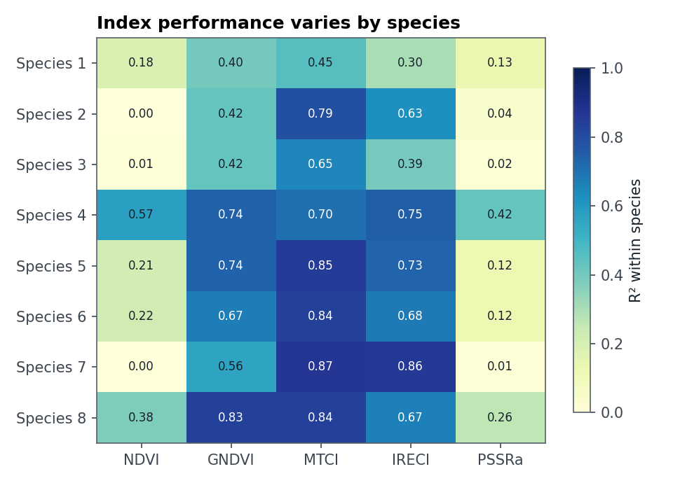

# Leaf Chlorophyll from Vegetation Indices

[](https://github.com/7ao6688-hash/leaf-chlorophyll-indices/actions/workflows/ci.yml)
[](https://www.python.org/)
[](LICENSE)

Which Sentinel-2 vegetation index best tracks chlorophyll, the pigment that tells you how healthy and productive vegetation is? This project tests five common indices at two scales: on **160 leaves of 8 species** measured with a lab spectroradiometer, and on **87 New Forest plot observations** (April–October 2016) seen by Sentinel-2.



## Key findings

- **MTCI is the strongest single index.** It explains 75% of chlorophyll variation within a species on average, and 76% of canopy chlorophyll (CCC) across the Sentinel-2 plots.
- **IRECI transfers best between species.** Pooling all 160 leaves, it gives R² = 0.63, and its error barely grows when a whole species is held out (RMSE 36 → 37 µg/cm²).
- **NDVI and PSSRa are poor chlorophyll indicators** (R² ≤ 0.21 in the lab). They saturate on dense, healthy leaves.
- **The satellite relationships are stronger for canopy chlorophyll than for leaf chlorophyll**, because the canopy signal also includes leaf area (LAI).

| Index | Formula (S2 bands) | Lab R², within species | Lab R², pooled | Lab RMSE, species held out (µg/cm²) | S2 R², LCC | S2 R², CCC |
|---|---|---:|---:|---:|---:|---:|
| MTCI | (B6 − B5)/(B5 − B4) | **0.75** | 0.58 | 40.3 | **0.67** | **0.76** |
| IRECI | (B7 − B4)/(B5/B6) | 0.63 | **0.63** | **37.4** | 0.41 | 0.50 |
| GNDVI | (B7 − B3)/(B7 + B3) | 0.60 | 0.49 | 44.2 | 0.51 | 0.58 |
| NDVI | (B7 − B4)/(B7 + B4) | 0.20 | 0.14 | 57.0 | 0.44 | 0.52 |
| PSSRa | B7/B4 | 0.14 | 0.21 | 53.2 | 0.28 | 0.34 |



## Lab scale

Leaf reflectance was measured from 350 to 1050 nm and resampled to Sentinel-2 bands B3 to B7. Chlorophyll was measured on the same leaves.





Performance depends on species: NDVI explains almost nothing for species 2, 3 and 7, while MTCI stays above 0.65 for every species except species 1.

## Method

1. Resample each leaf spectrum to Sentinel-2 bands. The default, `point`, samples the band centre wavelength and reproduces the original coursework exactly. The alternative, `window`, averages over each band's nominal width.
2. Compute the five indices. B7 (783 nm) is used as NIR, following Frampton et al. (2013).
3. Fit index → chlorophyll linear models and report R², RMSE, exact leave-one-out RMSE, and leave-one-species-out RMSE. The last shows how a model fitted on known species performs on a new one.
4. Repeat at canopy scale with Sentinel-2 L2A reflectance at the field plots, recomputing every index from the band values.

## Relation to the original coursework

This rebuilds an MSc coursework analysis (University of Southampton, 2025). The original report quoted two inconsistent sets of R² values. Recomputing from the raw data shows they are two different statistics. The table in the report is close to the **mean within-species R²**, and the text is close to the **pooled R²**. Both are reported above, side by side and labelled.

## Run it

```bash
python -m pip install -e .
chlorophyll-indices --spectra Lab_Leaf_Spectra.xlsx --chlorophyll Lab_Chlorophyll_Conc.xlsx \
    --satellite Satellite_Field_data.xlsx --output-dir results
python -m unittest discover -s tests -v
```

The readers expect the course workbook layout: one sheet per species, wavelengths in column B and one column per leaf. The measurements were collected by student groups and supplied by the course, so they aren't redistributed here. The repository holds the code, the derived results and synthetic-data tests.

## Limits

- Lab spectra are of single leaves under controlled light. Real Sentinel-2 pixels mix leaves, branches, soil and shadow at 20 m.
- The satellite comparison covers one region (the New Forest, UK) across 10 Sentinel-2 dates from April to October 2016, so these models shouldn't be applied elsewhere without recalibration.
- Linear models are used for comparability. Some indices are clearly non-linear near saturation.

## Licence

MIT. See [LICENSE](LICENSE).
